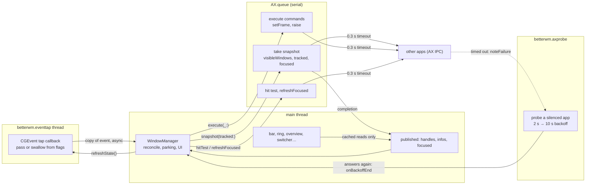
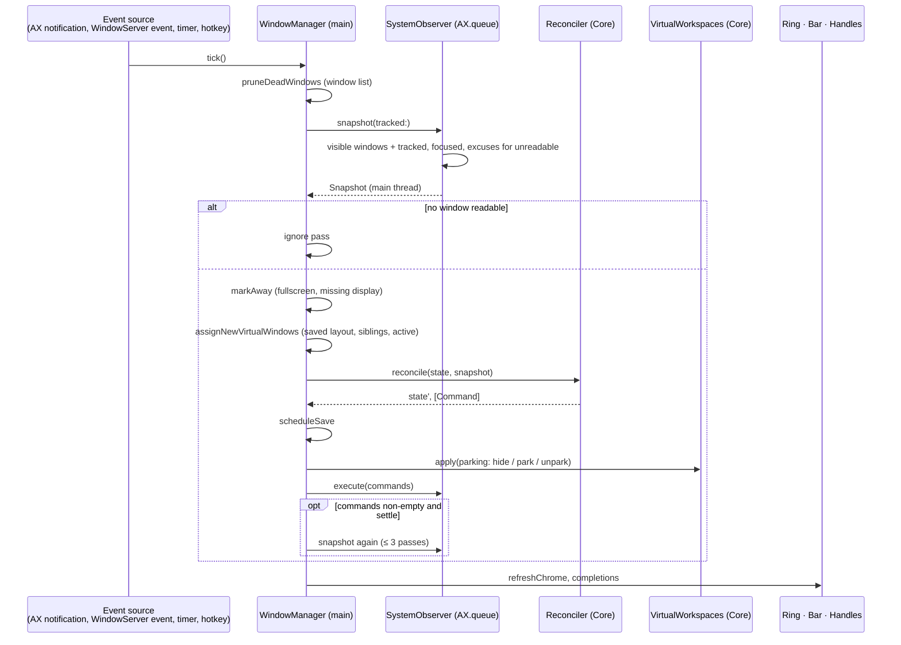
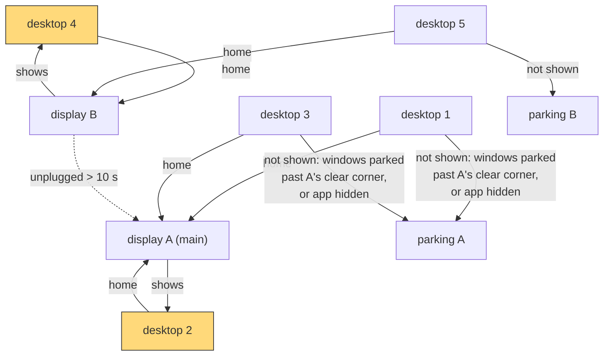
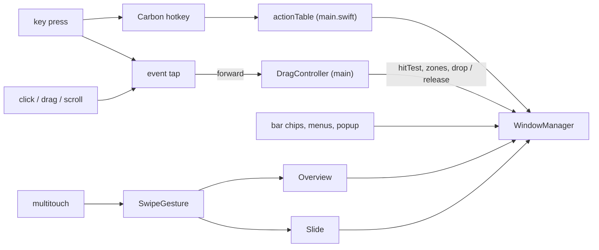

# Architecture

Diagrams of how BetterWM is put together. [Internals](internals.md) explains the rules; this page shows the shape.

## Targets and modules

Two targets: `BetterWMCore` is pure Swift with no AppKit and no system calls, which is what makes it testable; `BetterWM` is the app, which talks to macOS.

```mermaid
flowchart TB
    subgraph Core["BetterWMCore (pure, tested)"]
        Model["Model<br/>WindowInfo · ScreenInfo · Snapshot · Command"]
        Grid["Grid · GridGeometry<br/>columns, weights, zones, resizing"]
        Reconciler["Reconciler · DesiredState<br/>arrivals, departures, min sizes, refusals"]
        VW["VirtualWorkspaces<br/>desktops, homes per display, parking"]
        Parking["Parking<br/>corner clear of other displays"]
        DragRules["DragRules<br/>drop / release / snap back"]
        Config["Config<br/>parse, serialize, migrate, actions"]
        Persistence["SavedLayout<br/>state.json, restore by title"]
        Presets["LayoutPreset"]
    end

    subgraph App["BetterWM (AppKit, SkyLight, Accessibility)"]
        direction TB
        WM["WindowManager<br/>the one owner of state"]
        SO["SystemObserver<br/>snapshots on AX.queue"]
        AX["AXWindow · AXResponsiveness · AX.queue"]
        Spaces["Spaces · CGWindowInfo<br/>SkyLight, window list"]
        WSE["WindowServerEvents<br/>move/reorder/create events"]
        WO["WindowObserver<br/>AX notifications per app"]
        Drag["DragController<br/>event tap, own thread"]
        HotKey["HotKey (Carbon)"]
        Gestures["SwipeGesture (multitouch)"]
        subgraph UI["UI"]
            Bar["StatusBar · BarCat"]
            Ring["FocusRing"]
            Overlay["ZoneOverlay · HandleWindow"]
            Overview["Overview"]
            Slide["DesktopSlide"]
            Switcher["WindowSwitcher"]
            Popup["ActionPopup · ActionHUD"]
            Settings["ConfigEditor · Onboarding"]
        end
        Main["main.swift (AppDelegate)<br/>wiring, menu, actions"]
    end

    WM --> Reconciler
    WM --> VW
    WM --> Grid
    WM --> Persistence
    WM --> Parking
    WM --> SO
    SO --> AX
    SO --> Spaces
    AX --> Spaces
    WM --> WSE
    WM --> WO
    Drag --> DragRules
    Drag --> WM
    Main --> WM
    Main --> HotKey
    Main --> Gestures
    Main --> UI
    UI --> WM
    Settings --> Config
    WM --> Config
```



## Threads and queues

Nothing on the main thread waits for another app. Every Accessibility message runs on one serial queue; the event tap has its own thread; the main thread reads only what the last snapshot published.



## One layout pass (`tick`)



## Desktops, displays and parking



- Desktops are numbered globally; each has a home display (by UUID) remembered across launches.
- A vanished display keeps its desktops for 10 s; after that they show on the main display and return when it is back.
- Grids are keyed by desktop (`VirtualWorkspaces.spaceID`), so a desktop carries its layout to whatever display it is on.

## Input paths



## Persistence

```mermaid
flowchart LR
    Config["config.conf<br/>Config.parse / serialize<br/>schema 3, migrated"] --> WM
    State["state.json<br/>SavedLayout schema 3<br/>grids by desktop, floating frames,<br/>desktop homes, shown per display"] <--> WM["WindowManager"]
    Cats["cats.json<br/>cat memory"] <--> BarCat
    Log["log.txt (2 MB, rotated)"] <-- Log.write --- All["every component"]
```
