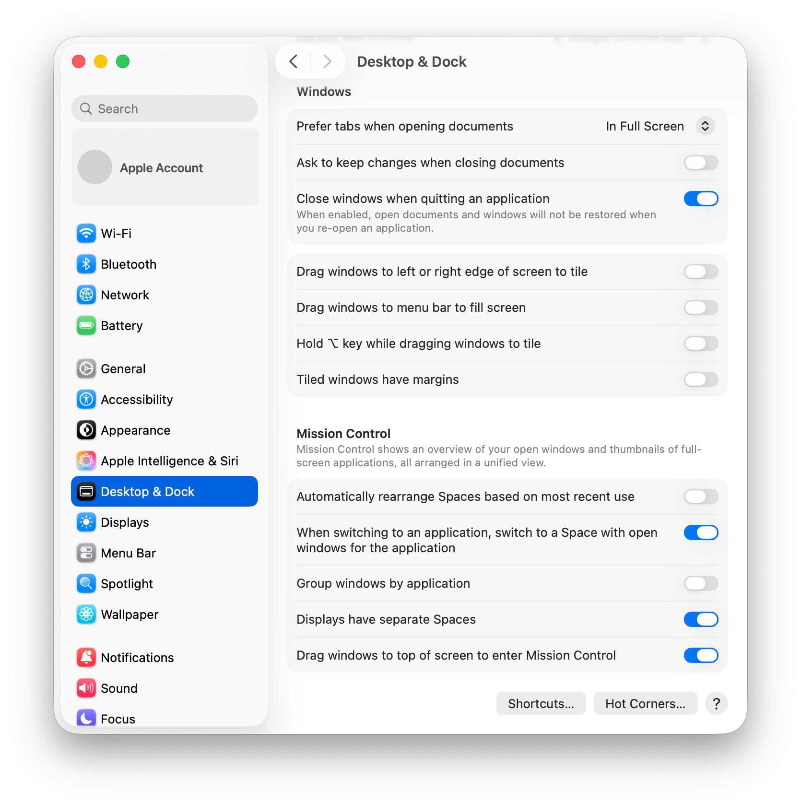
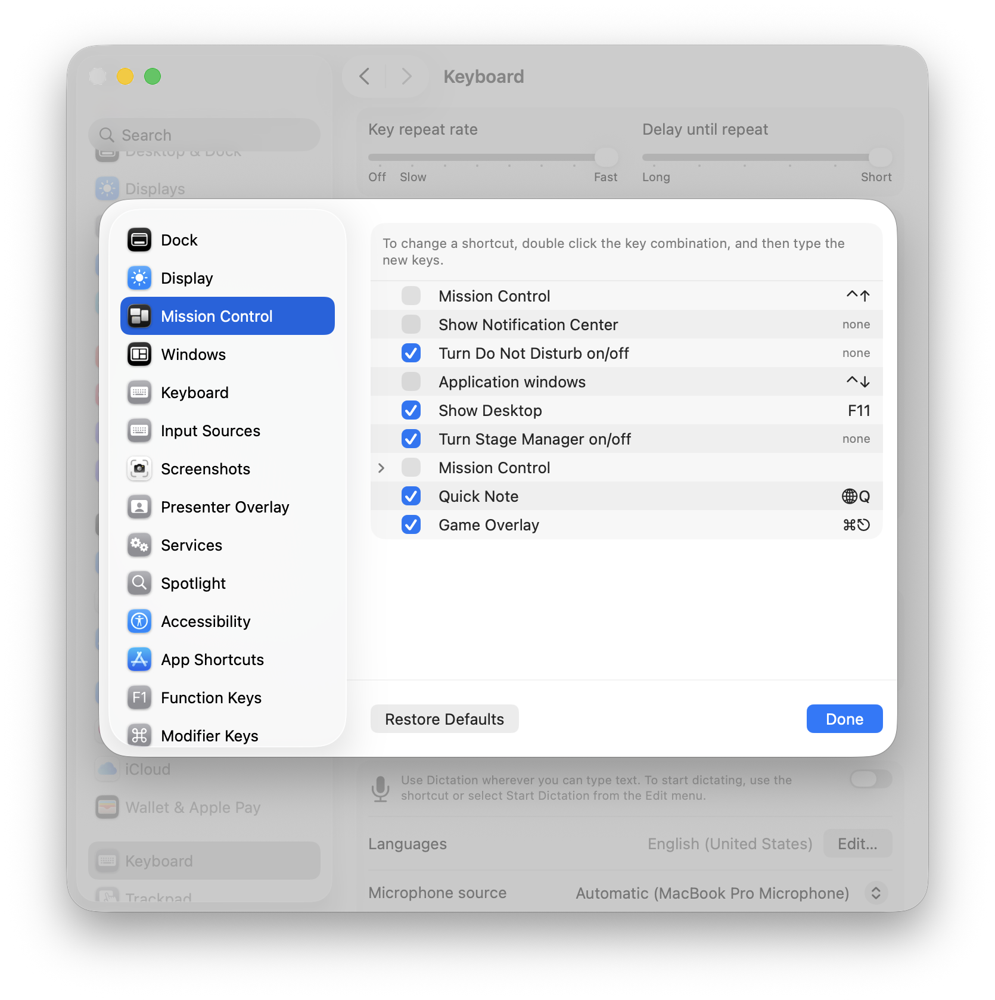
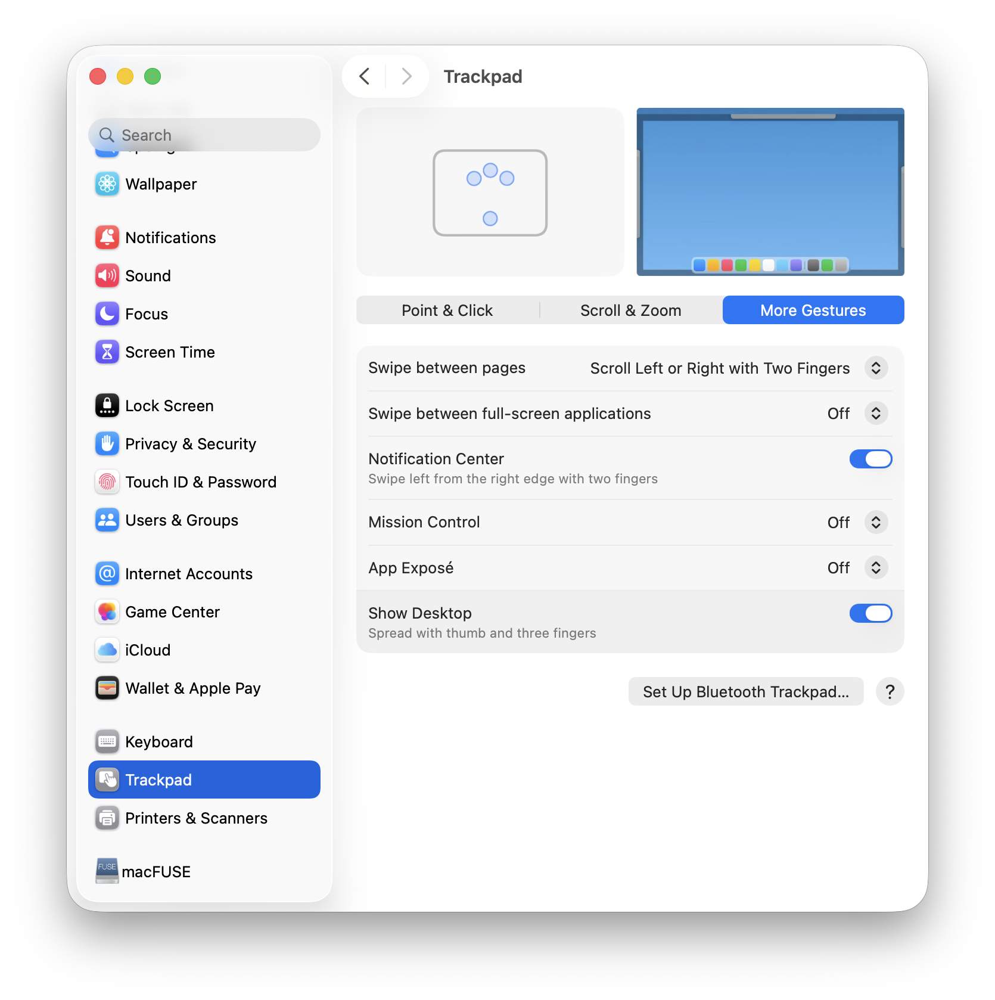

# Getting started

## Install

Homebrew:

```sh
brew install --cask nanot1m/tap/betterwm
```

Or [download BetterWM.dmg](https://github.com/nanot1m/better-win-manager/releases/latest/download/BetterWM.dmg), open it and drag BetterWM to Applications. Releases are signed with a Developer ID and notarized, so macOS opens them like any other app. Updates: the app checks once a day and offers new releases; Settings › Updates can install them automatically.

From source, with Command Line Tools only (no Xcode): `make install` builds, bundles, signs and copies to Applications.

## Permissions

| Permission | Needed for | When asked |
| --- | --- | --- |
| Accessibility | Reading and moving windows. Nothing works without it | First launch; the app waits until granted |
| Screen Recording | Window previews in the ⌥Tab switcher and the desktop overview | Optional; without it both show app icons |

On first launch, while Accessibility is missing, a welcome window lists both permissions with a button to the right System Settings pane each; it notices when a permission is granted, no relaunch needed. It is available later from the menu as Permissions…
| Location Services | Weather for your current position | Optional; set a fixed `barWeatherLocation` instead |

## The first five minutes

1. **Your desktops** show as numbers in the system menu bar, next to the BetterWM icon: click one to switch, drop a window on one to send it there (`menuBarChips`, `menuBarChipStyle`). Prefer a bar of its own? Turn on the status bar in Settings (`bar`); it is meant to replace the system menu bar, so set "Automatically hide and show the menu bar" to Always in System Settings › Control Center when you do.
2. **Tile a window.** Hold ⌥ and drag any window. Drop zones light up: the left or right half of another window makes a new column on that side, the top or bottom half stacks it in that column. Let go to tile. Tiled windows drag the same way without ⌥, and dragging their edges resizes the tiles.
3. **Untile.** Move or resize a tiled window by hand and it leaves the grid, or press ⌃⌥T. Toggling again puts it back where it floated.
4. **Switch desktops.** ⌃1 to ⌃9, or click a chip in the bar. Desktops beyond the ones you have are created the moment you switch or send a window to them, and disappear again when empty. ⌃⌥1 to ⌃⌥9 send the focused window.
5. **The welcome tour** (Welcome & Setup… in the menu) walks through all of this: permissions, where to show the desktops, and the three macOS settings to hand over, each with a button to the right pane.
6. **Everything else** is in the menu behind the BetterWM icon in the menu bar (or the grid button at the right end of the status bar), and in the Window Actions popup, ⌥⌘Space.

The windows open when a desktop is first seen are tiled left to right. Turn that off with "Tile existing windows" in Settings › General if you would rather start from a clean slate.

## Set up macOS once

BetterWM takes over what Mission Control did; three settings keep the two from fighting.

1. **Keep one native desktop, shared by all displays.** BetterWM's desktops replace macOS Spaces: they switch instantly, keep their layouts and live on a display each. Extra native desktops only add a second, slower set of places for windows to hide. In Mission Control, close every desktop but the first, and turn off "Displays have separate Spaces" (System Settings › Desktop & Dock › Mission Control), as AeroSpace recommends too: with it on, every display carries its own set of Spaces and native fullscreen windows live in Spaces BetterWM cannot always switch to. Log out and in for the change to apply, or run:

   ```sh
   defaults write com.apple.spaces spans-displays -bool true && killall SystemUIServer
   ```

   

2. **Free the Mission Control shortcuts.** macOS claims ⌃← ⌃→ and ⌃1–⌃9 for its own desktops, so they never reach BetterWM until you turn them off: System Settings › Keyboard › Keyboard Shortcuts › Mission Control, untick both Mission Control rows and Application windows.

   

3. **Hand over the gestures and F3.** System Settings › Trackpad › More Gestures: set Mission Control, App Exposé and "Swipe between full-screen applications" to Off, then BetterWM's three- or four-finger swipe moves between its desktops and the Mission Control key opens its overview.

   

## Where things are

- Settings: the menu, or `~/.config/betterwm/config.conf` plus Reload Config.
- Layouts: `~/.config/betterwm/state.json`, written automatically and restored on launch.
- Log: `~/.config/betterwm/log.txt`; Copy Diagnostics Report in the menu bundles it with your config and state for a bug report.
